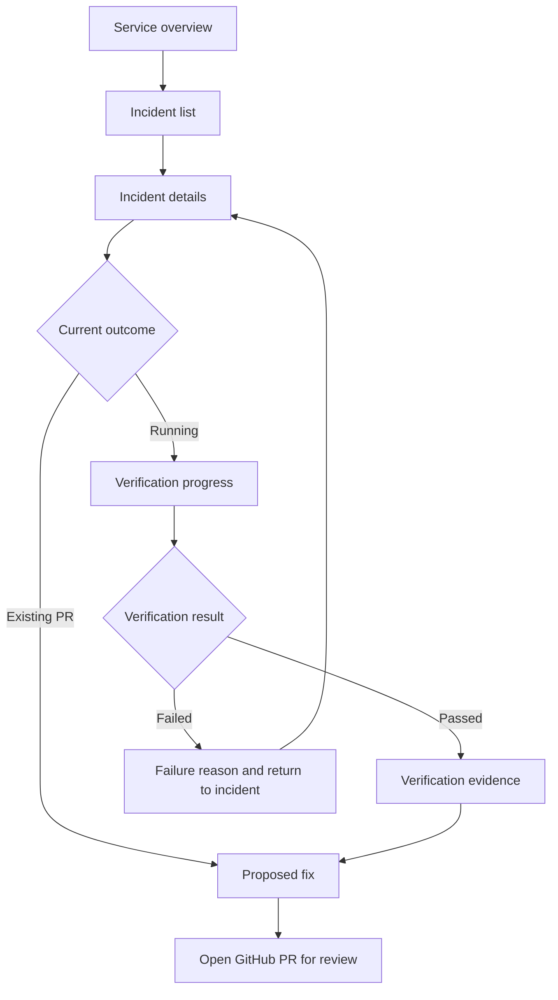
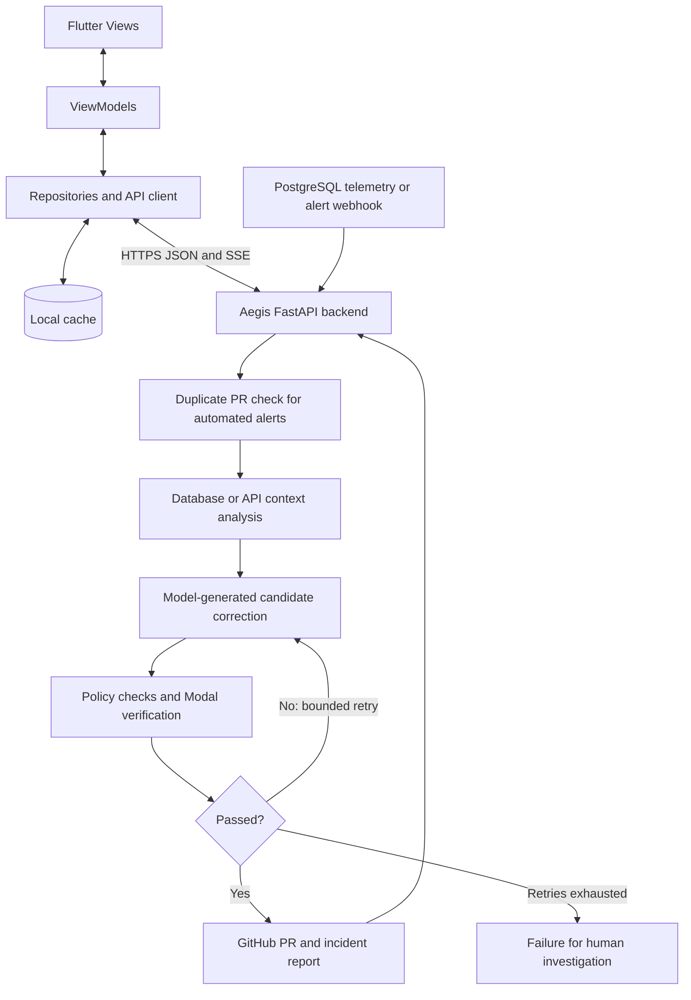

# Aegis Mobile

**A mobile companion for monitoring incidents, following automated verification, and reviewing proposed fixes.**

**Course:** MTM4681 — Mobile Programming, Fall 2026  
**Contributor:** MOHAMED SALEM M. ELABİAD ([Msalem102](https://github.com/Msalem102))  
**Submission:** Individual · Milestone 1  
**Repository:** https://github.com/Msalem102/personal-insight

This repository now contains the **Aegis Mobile** project plan. It replaces the earlier Personal Insight concept while retaining the existing repository URL and commit history.

## The problem

An on-call engineer needs to understand what failed, whether a candidate fix has been tested, and where to review it—even when away from a workstation. Aegis Mobile presents this information in a focused mobile workflow.

The design builds on [Aegis SRE by Ahmed Harib](https://github.com/ahmedharib/Aegis-SRE), whose backend investigates database performance problems and breaking upstream API changes, verifies candidate corrections in isolated environments, and delivers GitHub pull requests.

## Main capabilities

| Capability | Planned mobile experience |
|---|---|
| Service overview | See the active service, monitor state, connection state and incident summary. |
| Incident browsing | Identify database contention or API contract drift and inspect the affected service. |
| Diagnosis | Read a concise explanation of the problem and relevant evidence. |
| Verification progress | Follow diagnosis, candidate generation, testing and outcome. |
| Verification results | Compare database latency or inspect targeted API test results. |
| Proposed fix review | Review the change summary and open the corresponding PR on GitHub. |

**A verified candidate or an open PR is not a deployed production fix.** The app will label these states separately.

## User journey



The milestone focuses on six main mobile screens, plus failure, existing-PR and disconnected variants. The database incident is the primary prototype story; the API incident reuses the same layouts.

## Overview and architecture

The proposed Flutter client uses **MVVM**. The backend retains the upstream Aegis separation between telemetry, diagnosis, generation, sandbox verification and GitHub delivery.



Remote authentication, durable mobile-facing incident state and local caching are proposed additions. The Flutter client is not implemented yet. See [architecture](docs/ARCHITECTURE.md) and [protocols/interfaces](docs/PROTOCOLS.md).

## Milestone deliverables

| Deliverable | Location or link | Status |
|---|---|---|
| Design justification PDF, 1–2 pages | `docs/Design_Justification.pdf` | Pending |
| User flow PDF | `docs/User_Flow.pdf` | Pending |
| Architecture and protocols PDF | `docs/Architecture_and_Protocols.pdf` | Pending |
| Figma wireframes | Link to be added | Pending |
| Figma high-fidelity mockups | Link to be added | Pending |
| Figma interactive prototype | Link to be added | Pending |

The Markdown documents in this repository are planning sources; they do not replace the required PDFs or editable Figma work.

## Repository structure

```text
README.md
docs/
  ARCHITECTURE.md
  PROTOCOLS.md
  USER_FLOW.md
  ROADMAP.md
  SUBMISSION_CHECKLIST.md
design/
  README.md
```

Final PDFs will be added under `docs/`. Editable designs stay in Figma, with view links in this README. A Flutter implementation directory will be introduced when development begins.

## Development status

Architecture and milestone preparation only. This update does not import the upstream Python implementation, create a runnable Flutter app, or claim new benchmark/test results. The next deliverables are the Figma designs and three PDFs.

For future implementation, cached incident summaries and user notes/bookmarks can provide a bounded local-data feature, with backend-sourced incident results as the online feature. Persistence, ownership and synchronization details will be finalized before implementation.

## Attribution

The upstream Aegis SRE architecture and backend are authored by **Ahmed Harib**. This individual course project concerns the proposed mobile companion and its design/architecture documentation. Upstream code authorship is not claimed.

- [Aegis SRE source](https://github.com/ahmedharib/Aegis-SRE)
- [Upstream database workflow](https://github.com/ahmedharib/Aegis-SRE/blob/master/aegis_vector_a_runner.py)
- [Upstream API workflow](https://github.com/ahmedharib/Aegis-SRE/blob/master/aegis_vector_b_runner.py)
- [Course milestone instructions](https://github.com/f-kiran/mtm4681-Mobile-Programming#project-milestone-1)
