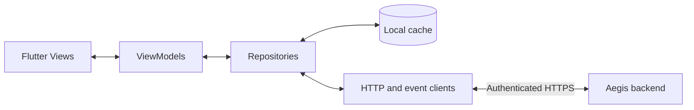

# Aegis Mobile — architecture

**Status:** proposed mobile architecture based on the existing Aegis SRE backend. No mobile implementation is claimed.  
**Submission repository:** https://github.com/Msalem102/personal-insight

## Design goals

Help an on-call engineer understand an incident quickly, inspect verification evidence, and open a proposed fix for human review. Keep resource-intensive analysis and credentials on the backend. Keep the mobile presentation readable, responsive and explicit about stale data or failed checks.

## Mobile pattern: MVVM

| Part | Responsibility | Examples |
|---|---|---|
| View | Render state and collect user actions | Overview, incident list, incident details, progress, verification result, proposed fix |
| ViewModel | Loading/error/content state, selected incident, progress mapping and actions | OverviewViewModel, IncidentListViewModel, IncidentDetailViewModel |
| Model | Typed domain data | Service, Incident, VerificationResult, PullRequestSummary |
| Repository | Coordinate remote data and local cache | IncidentRepository, ServiceRepository |
| API/event services | JSON requests, event subscriptions, reconnection | AegisApiClient, EventStreamClient |
| Local persistence | Last known summaries, preferences and later optional notes/bookmarks | Cache with retrieval timestamp and stale indicator |

The repository/service layer supports MVVM without coupling screen code to FastAPI payloads or network libraries.

## Backend architecture inherited from Aegis SRE

| Upstream component | Responsibility |
|---|---|
| `core/telemetry/` and `core/webhooks/` | Observe database activity and accept/classify alerts |
| `core/db/` | Inspect database context and check generated SQL |
| `core/analysis/` and `core/diff/` | Locate affected code and compare API contracts |
| `core/llm/` | Generate candidate corrections and incident reports |
| `core/sandbox/` | Execute isolated performance checks or target tests |
| `core/delivery/` | Create diffs, commits and GitHub pull requests |
| `core/config/` | Load service configuration |
| `aegis_vector_a_runner.py` | Orchestrate database remediation |
| `aegis_vector_b_runner.py` | Orchestrate API contract remediation |
| `core/webhooks/listener.py` | FastAPI interfaces, events and incident results |
| `core/ui/` | Existing browser dashboard; the proposed mobile client is a separate presentation layer |

## Database incident sequence

1. Telemetry or an alert identifies a slow query or scan surge.
2. Automated handling checks for an existing matching PR.
3. The backend gathers query, schema and plan context through its inspector.
4. The model generates an index migration.
5. SQL policy checks reject disallowed patterns and check index safeguards.
6. A Modal database sandbox evaluates query performance with the candidate migration.
7. Failed verification feeds a bounded retry loop; successful verification produces a PR and report.
8. The mobile client shows verification evidence and the PR link.

The default performance threshold documented by the upstream project is 80% latency reduction. It is a configured acceptance criterion, not a guarantee for every incident.

## API contract incident sequence

1. A webhook or failing verification reveals a runtime/API-contract problem.
2. The backend uses two specifications, a target specification, or runtime error context to infer the change.
3. Dependency analysis identifies affected models and client code.
4. The model proposes a patch.
5. The isolated test environment runs the configured target tests.
6. Failure feeds a bounded retry loop; passing candidates can be delivered as a PR and report.

## Mobile state model

Proposed display states: **Detected → Diagnosing → Generating → Verifying → Verified / Failed → PR ready**. An existing-PR outcome skips creating a duplicate candidate. Deployment/resolution is not inferred from verification.

These are presentation requirements. Existing events include log-like messages; reliable typed stage updates and per-incident correlation may require backend additions. The existing backend can report `REMEDIATED` when a candidate has been verified and delivered; the client should instead show the concrete outcome.

## Existing versus planned

| Existing upstream behavior inspected | Proposed mobile work |
|---|---|
| FastAPI status, services and incident-result routes | Flutter screens and typed model mapping |
| Server-sent event stream and log endpoint | Foreground event subscription and resume/reconnect behavior |
| Isolated candidate verification | Mobile progress/evidence presentation |
| GitHub PR delivery; local simulation when token is absent | Show live PR links only for confirmed live delivery |
| Manual remediation can bypass duplicate checks | Explicit action state and duplicate-action prevention |
| Backend configuration and external integrations | Authenticated remote access and per-user authorization |
| In-process incident history in the inspected listener | Durable incident storage and bounded local caching |

## Data boundaries and failure behavior

The mobile client never receives PostgreSQL, model-provider, Modal or GitHub service credentials. Those remain server-side. Remote authentication/session handling is a proposed addition; the current development listener must not be assumed to provide it.

Cached results show their last-refresh time. Disconnection preserves readable cached summaries and disables actions needing the server. Reconnection refreshes incident state before accepting new actions. A verification failure exposes the reason and returns the user to the incident; it does not create a success screen.

Background push notifications, automatic production deployment, in-app PR merging and broad administrative configuration are outside the milestone scope.

## Source and attribution

Architecture adapted from [Aegis SRE by Ahmed Harib](https://github.com/ahmedharib/Aegis-SRE), particularly its [database runner](https://github.com/ahmedharib/Aegis-SRE/blob/master/aegis_vector_a_runner.py), [API runner](https://github.com/ahmedharib/Aegis-SRE/blob/master/aegis_vector_b_runner.py), [listener](https://github.com/ahmedharib/Aegis-SRE/blob/master/core/webhooks/listener.py) and [delivery engine](https://github.com/ahmedharib/Aegis-SRE/blob/master/core/delivery/github_delivery.py). No upstream implementation is copied in this milestone structure.
