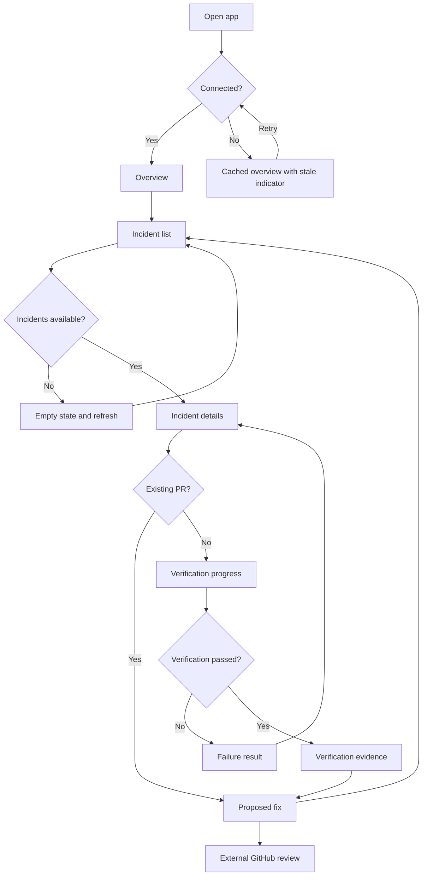

# Mobile user flow

**Status:** source plan for the required user-flow PDF and Figma prototype.  
**Submission repository:** https://github.com/Msalem102/personal-insight

## Main screens

| ID | Screen | Content and primary action |
|---|---|---|
| 01 | Overview | Active service, connection/monitor state, latest incident → View incidents |
| 02 | Incidents | Type, severity label, service, timestamp and stage → Open incident |
| 03 | Incident details | Problem, symptoms, affected component and diagnosis → View progress |
| 04 | Verification progress | Diagnosis, candidate generation, testing and outcome → View result |
| 05 | Verification result | Passed/failed; benchmark or targeted test count → Review proposed fix |
| 06 | Proposed fix | Change summary, affected files, verification evidence and PR → Open GitHub |

## Flow

The flow diagram shows the main path and meaningful decisions. The Figma prototype should demonstrate the successful database path, a failed-verification variant, and an existing-PR shortcut. All drill-down screens need a clear back action.

## Example content

Use a database contention incident for the main story and an API contract drift incident for the secondary list entry. If using upstream recorded benchmarks, label them as recorded sandbox examples. Verification success ends at **Verified · PR ready**, not **Production fixed**.

## Figma organization

- Cover and flow.
- Wireframes: six grayscale screens and state variants.
- UI kit: text/color styles, buttons, cards and status badges.
- Mockups: polished screens using the same content and navigation.
- Prototype: clearly defined starting point with linked actions and back navigation.

Editable work and actual prototype links remain pending.
